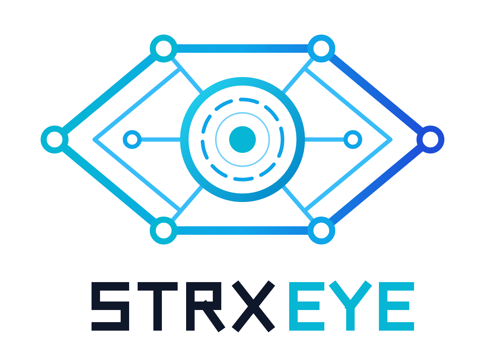

<p align="center"></p>

# STRX EYE

STRX EYE is a local-first OSINT investigation tool for domains, IP addresses and
AS numbers. It collects from public sources (DNS, RDAP registries, Certificate
Transparency, BGP data, the Internet Archive), keeps every fact together with its
source, timestamp, confidence and the raw response it came from, and builds an
investigation graph you can explore, compare over time and export.

It has a command-line interface (`strxeye`) and a browser-based desktop UI. Both
run on the same Python engine and the same local SQLite database.

**Status: 0.1.0, alpha.** The collectors, storage, CLI, local API and UI listed
below work and are tested. Several things planned for later milestones are not
built yet; see [What is not done yet](#what-is-not-done-yet).

## What it does

- **Passive collection by default.** A fresh install only queries third-party
  public services. Nothing contacts the target's own servers unless you ask for
  direct collection for a run (`--direct`) or turn it on in settings.
- **Evidence for every observation.** Each fact records the collector, method,
  UTC time, confidence and the SHA-256 of the stored raw response, so you can
  open the exact DNS answer or RDAP JSON a value was parsed from.
- **Observed vs inferred.** Relationships reported by sources are kept apart
  from links STRX EYE suggests (shared IP or certificate, likely hosting
  provider). Inferred links carry low confidence and a written explanation, and
  shared infrastructure is never presented as proof of common ownership.
- **Run history.** Re-running a target adds a new run instead of overwriting.
  You can diff two runs; collectors that failed in either run are excluded from
  the comparison so an outage does not look like a change.
- **Reports** in HTML, JSON and CSV, separating observations, inferred
  relationships and rule-based interpretations.
- **Private by default.** Data stays in a local SQLite file. No telemetry, no
  accounts, no API keys needed.

## Collectors

| Name | Accepts | What it collects | Contacts |
|---|---|---|---|
| `dns` | domain | A, AAAA, CNAME, MX, NS, TXT (SPF), SOA, CAA, DMARC | your DNS resolver |
| `rdap` | domain, IP, ASN | registrar, dates, status, DNSSEC, nameservers; network block and owner; AS holder | data.iana.org, the responsible registry / RIR |
| `crtsh` | domain | logged certificates, issuers, subdomains | crt.sh |
| `reverse_dns` | IP | PTR records | your DNS resolver |
| `asn` | IP, ASN | announcing AS, BGP prefix, AS name | Team Cymru (via DNS) |
| `wayback` | domain, URL | first/latest capture, one capture per year | web.archive.org |
| `http` *(direct)* | domain, URL | status, redirects, security headers, cookie flags, technology hints, robots.txt | the target |
| `tls` *(direct)* | domain, URL | served certificate, protocol, cipher, validation result | the target |

Registration data is filtered on purpose: STRX EYE keeps registrar and
organisation names but never stores personal names, emails, phone numbers or
addresses from RDAP, and never stores cookie values from HTTP responses.

## Install

Requires Python 3.12 or newer. Building the UI also needs Node.js 20+.

```bash
git clone <repository-url> strx-eye
cd strx-eye
python -m venv .venv
# Windows: .venv\Scripts\activate    Linux/macOS: source .venv/bin/activate
pip install -e ".[server]"
```

That gives you the CLI. To also get the UI, build it once and copy it into the
Python package:

```bash
cd apps/desktop
npm ci
npm run bundle
```

Packaged installers are not available yet.

## Using the CLI

One-off lookups print to the terminal and store nothing:

```bash
strxeye domain example.com
strxeye domain example.com --expand          # also look up owners/ASNs of resolved IPs
strxeye domain example.com --direct          # also fetch headers and TLS cert from the site
strxeye ip 1.1.1.1
strxeye asn AS13335
strxeye dns example.com
strxeye cert example.com
strxeye lookup https://example.com/          # detects the target type
```

Investigations keep results, evidence and history:

```bash
strxeye investigate create "Phishing kit infrastructure" -d "Ticket 4512, authorised by IR lead"
strxeye investigate run 3fa2 example.com --expand      # IDs can be shortened to a unique prefix
strxeye investigate show 3fa2
strxeye investigate entities 3fa2 --type ip
strxeye investigate evidence 3fa2 <sha256-prefix>      # print a stored raw response
strxeye investigate diff 3fa2 <older-run> <newer-run>
strxeye graph export 3fa2 -o graph.json
strxeye report 3fa2 --format html -o report.html
strxeye investigate delete 3fa2
```

Every command that prints data accepts `--json`. Other commands:
`strxeye collectors`, `strxeye config show`, `strxeye config set KEY VALUE`,
`strxeye plugins list|trust|untrust`.

Exit codes: `0` success (including "nothing found"), `1` finished but some
collectors failed, `2` invalid input, `3` every collector failed, `4`
investigation/run/evidence not found, `130` interrupted.

## Using the UI

```bash
strxeye serve
```

This starts the local engine on `127.0.0.1:8765` and prints a one-time link
(`http://127.0.0.1:8765/auth?token=...`). Open it in a browser. The UI has:

- **Overview** of investigations, with filtering.
- **Collect**: enter a target, pick collectors, allow direct collection or IP
  expansion, watch per-collector progress, cancel a run.
- **Entities**: searchable, filterable table; the detail pane shows every
  observation with source, time, confidence and a link to its raw evidence.
- **Graph**: Cytoscape view with type filters, search, inferred-link toggle,
  folding of leaf nodes, relationship provenance, and PNG/SVG/JSON export.
- **Evidence**: all stored raw responses.
- **History**: diff between two runs of the same target.
- **Report**: HTML preview and HTML/JSON/CSV download.
- **Collectors**, **Audit log**, **Settings** (theme and collection settings).

Keyboard: `Ctrl+K` command palette, `Ctrl+Alt+N` new investigation, `Alt+1`…`Alt+6`
switch workspace tabs, `/` focus entity search.

The server only listens on loopback, requires the token on every API call, and
rejects requests whose Host header is not a loopback name.

## Where data is stored

| | Windows | Linux | macOS |
|---|---|---|---|
| Config | `%LOCALAPPDATA%\strxeye\config.toml` | `~/.config/strxeye/config.toml` | `~/Library/Application Support/strxeye/config.toml` |
| Database | `%LOCALAPPDATA%\strxeye\strxeye.db` | `~/.local/share/strxeye/strxeye.db` | `~/Library/Application Support/strxeye/strxeye.db` |

`strxeye config show` prints the actual paths. Set `STRXEYE_HOME=/some/folder`
to keep config and database together (for example one folder per engagement).

Deleting an investigation removes its rows with SQLite `secure_delete` on and
then compacts the file. Copies made by backups, sync clients (OneDrive,
Dropbox) or SSD wear levelling are outside what the application can erase.

## Limitations

- Absence of data is not evidence of absence. Sources have gaps, delays and
  rate limits, and failures are reported per collector rather than hidden.
- crt.sh is often overloaded and returns HTTP 502/503 or times out; the
  collector retries, then reports an error. Re-run later.
- DNS results depend on the resolver used (`dns.nameservers`).
- The `asn` collector reports BGP origin; `rdap` reports the registered holder.
  They often differ (hosting customers, leased space); both are kept.
- Subdomains from Certificate Transparency show a certificate was issued, not
  that the name resolves today. They are stored with confidence 0.8.
- Technology detection is header- and markup-based and deliberately small.
- The correlation rules are simple and explained; they are hints for the
  analyst, not conclusions.

## What is not done yet

Planned for later milestones and **not** in 0.1.0:

- Native desktop packaging (Tauri). The UI runs in your browser via
  `strxeye serve` for now.
- Threat-intelligence feeds, hash reputation and indicator enrichment.
- Optional AI assistant.
- Direct PDF export (print the HTML report to PDF instead).
- OS keychain storage for API keys (no collector needs a key yet).
- Installers, signed releases and checksums.
- Screenshots in this README.

## Development

```bash
pip install -e ".[dev]"
pytest                 # unit tests, no network
pytest -m live         # a few checks against real public services
ruff check src tests

cd apps/desktop
npm ci
npm test               # Vitest
npm run typecheck
npm run dev            # UI dev server; run `strxeye serve` alongside with
                       # STRXEYE_API_TOKEN set to the same value in both shells
```

See [docs/architecture.md](docs/architecture.md), [docs/plugins.md](docs/plugins.md)
and [CONTRIBUTING.md](CONTRIBUTING.md).

## Responsible use

STRX EYE is for security research, incident response, journalism and
authorised assessments. It does not include features for locating private
individuals, harvesting credentials or bypassing access controls, and
contributions adding them will not be accepted. Only use direct collection
against systems you are authorised to contact.

## License

MIT. See [LICENSE](LICENSE).
